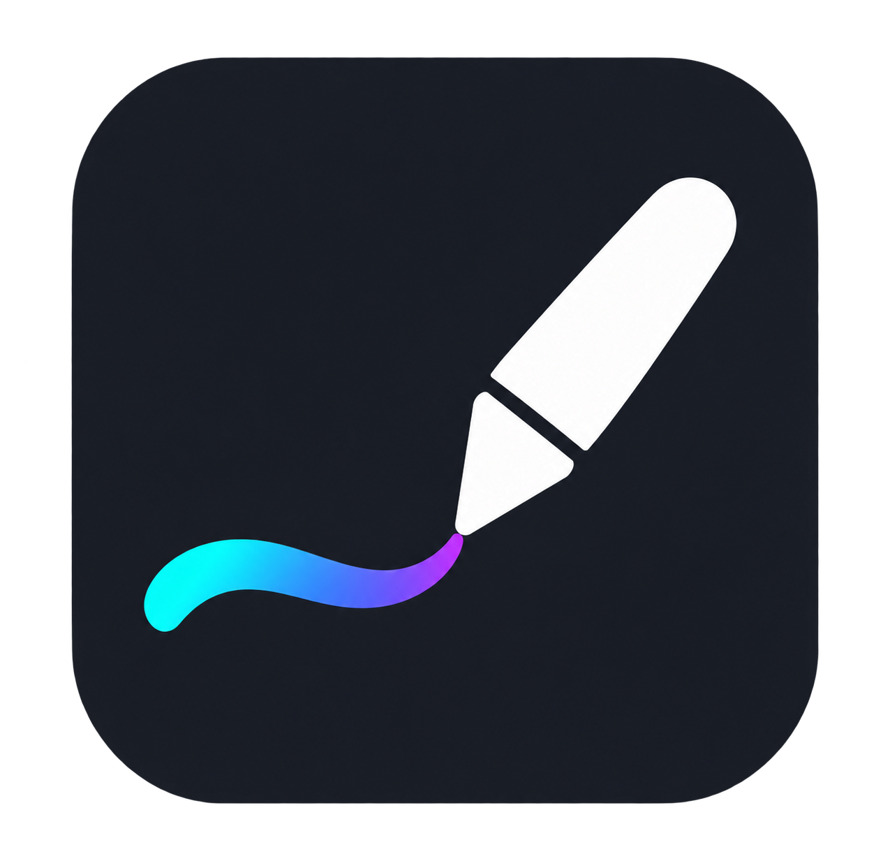
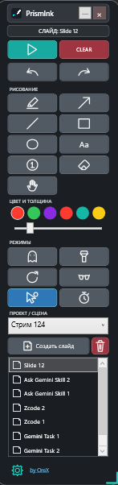

<p align="center"></p>
<h1 align="center">PrismInk</h1>
<p align="center">A portable Windows application for screen annotation, presentations, teaching, and live streams.</p>

<p align="center">
  
  
  
  
  
</p>

<p align="center"></p>

<a id="languages"></a>
<p align="center"><a href="#english">🇬🇧 English</a> | <a href="#russian">🇷🇺 Русский</a></p>

---

<a id="english"></a>
## 🇬🇧 English

**PrismInk** is a compact ScreenBrush-style desktop annotation tool for Windows. Draw over applications, browsers, videos, presentations, and multiple monitors, then organize the result into projects and slides.

### ✨ Features

- **Drawing tools:** freehand drawing, arrows, lines, rectangles, ellipses, text, numbered badges, eraser, selection, and element editing.
- **Projects and slides:** reorder and rename slides, remove a single monitor capture, or export a slide with all annotations to JPG.
- **Multi-monitor workflow:** captures the monitor where drawing begins and keeps backgrounds and annotations separate for each monitor.
- **Presentation modes:** flashlight, cursor highlight, fading ink, screen dimming, timer, and background refresh.
- **Non-destructive editing:** move, resize, recolor, edit, delete, undo, and redo individual elements.
- **OBS-friendly overlay:** annotations are visible with OBS Display Capture and Windows Graphics Capture.
- **Compact interface:** movable and scalable vertical toolbar plus a quick panel opened by right-clicking empty drawing space.
- **Customization:** six color slots, very fine line widths, three themes, and adjustable panel and outline transparency.
- **Localization:** English, Russian, Spanish, French, and German.
- **100% portable:** no installer; settings, palette, projects, slides, and screenshots stay inside the application folder.

### 📦 Download and start

1. Download `PrismInk-v1.0.0-win-x64.zip` from [GitHub Releases](https://github.com/orex2121/PrismInk/releases).
2. Extract the archive to any writable folder.
3. Run `PrismInk.exe`.

Keep `Locales` next to `PrismInk.exe`. The `output` directory, `settings.json`, and `palette.json` are created automatically. The self-contained build does not require a separate .NET installation.

Windows SmartScreen may warn about an unsigned application downloaded from the Internet. Review the file and choose **Run anyway** if you trust the download.

### 🚀 Quick start

1. Start PrismInk. It opens in normal Windows mode and does not immediately intercept the mouse.
2. Select a drawing tool and begin drawing. If no slide exists, a new slide is created automatically using the current monitor image.
3. Use the drawing-mode button or `Ctrl+Shift+P` to switch between annotation and normal Windows interaction.
4. Right-click an element to edit, recolor, or delete it. Right-click empty drawing space to open the quick panel.
5. Right-click a slide to save a JPG, rename or delete the slide, or remove one monitor capture.

### ⌨️ Controls

| Input | Action |
|---|---|
| `Ctrl+Shift+P` | Enter or leave drawing mode globally |
| `Ctrl+Z` / `Ctrl+Y` | Undo / redo |
| `←` / `→` | Previous / next slide while drawing |
| Hold `Shift` | Temporarily select and move elements |
| Middle-button drag | Move an element |
| Mouse wheel while drawing or editing | Change line width |
| Mouse wheel in Flashlight mode | Change spotlight radius |
| Right-click empty canvas | Open the quick-access panel |

The drawing-mode shortcut can be changed in **Settings**.

### 🎥 OBS and screen sharing

For live streams, add **Display Capture** in OBS so the desktop and PrismInk overlay are composited into one source. If Window Capture does not show annotations, switch it to Windows Graphics Capture or use Display Capture.

### 🗂 Portable data

```text
PrismInk/
├── PrismInk.exe
├── Locales/          # EN, RU, ES, FR, DE translations
├── output/           # Projects, slides, backgrounds, and timers
├── settings.json     # Application settings
└── palette.json      # Custom color palette
```

Back up the entire folder to preserve all projects and settings. Screenshots and drawings are processed locally; PrismInk requires no account, cloud service, analytics connection, or Internet access.

Created by [OreX](https://github.com/orex2121).

[⬆ Back to language selection](#languages)

---

<a id="russian"></a>
## 🇷🇺 Русский

**PrismInk** — компактная программа в стиле ScreenBrush для рисования поверх экрана Windows. Рисуйте поверх приложений, браузеров, видео и презентаций на нескольких мониторах, а затем сохраняйте результат в проектах и слайдах.

### ✨ Возможности

- **Инструменты рисования:** свободное рисование, стрелки, линии, прямоугольники, эллипсы, текст, номерные бейджи, ластик, выбор и редактирование элементов.
- **Проекты и слайды:** изменение порядка и названия слайдов, удаление снимка одного монитора и экспорт слайда со всеми обозначениями в JPG.
- **Несколько мониторов:** захватывается экран, на котором началось рисование; фон и элементы каждого монитора хранятся раздельно.
- **Режимы презентации:** фонарик, подсветка курсора, исчезающие чернила, затемнение экрана, таймер и обновление фона.
- **Редактирование:** перемещение, масштабирование, изменение цвета и текста, удаление, отмена и повтор отдельных действий.
- **Совместимость с OBS:** обозначения видны при использовании «Захвата экрана» и Windows Graphics Capture.
- **Компактный интерфейс:** перемещаемая и масштабируемая вертикальная панель и быстрое меню по правой кнопке мыши.
- **Персонализация:** шесть цветов, очень тонкие линии, три темы, прозрачность фона панели и контура линии.
- **Локализация:** английский, русский, испанский, французский и немецкий языки.
- **Полная портативность:** установка не нужна; настройки, палитра, проекты, слайды и снимки находятся в папке программы.

### 📦 Скачивание и запуск

1. Скачайте `PrismInk-v1.0.0-win-x64.zip` со страницы [GitHub Releases](https://github.com/orex2121/PrismInk/releases).
2. Распакуйте архив в любую папку с правом записи.
3. Запустите `PrismInk.exe`.

Папка `Locales` должна находиться рядом с `PrismInk.exe`. Папка `output`, файлы `settings.json` и `palette.json` создаются автоматически. Автономная сборка не требует отдельной установки .NET.

Windows SmartScreen может предупредить о неподписанном приложении из Интернета. Проверьте файл и выберите **Выполнить в любом случае**, если доверяете загрузке.

### 🚀 Быстрый старт

1. Запустите PrismInk. Программа открывается в обычном режиме Windows и не перехватывает мышь автоматически.
2. Выберите инструмент и начните рисовать. Если слайда ещё нет, он создастся со снимком текущего монитора.
3. Используйте кнопку режима рисования или `Ctrl+Shift+P` для переключения между рисованием и обычной работой в Windows.
4. Нажмите правой кнопкой по элементу для редактирования, изменения цвета или удаления. Правая кнопка на пустом месте открывает быстрое меню.
5. Нажмите правой кнопкой по слайду, чтобы сохранить JPG, переименовать или удалить слайд либо удалить снимок отдельного монитора.

### ⌨️ Управление

| Ввод | Действие |
|---|---|
| `Ctrl+Shift+P` | Глобальный вход или выход из режима рисования |
| `Ctrl+Z` / `Ctrl+Y` | Отмена / повтор действия |
| `←` / `→` | Предыдущий / следующий слайд в режиме рисования |
| Удерживание `Shift` | Временный выбор и перемещение элементов |
| Перетаскивание средней кнопкой | Перемещение элемента |
| Колесо при рисовании или редактировании | Изменение толщины линии |
| Колесо в режиме фонарика | Изменение радиуса подсветки |
| Правая кнопка на пустом холсте | Открытие быстрого меню |

Горячую клавишу режима рисования можно изменить в **Настройках**.

### 🎥 OBS и демонстрация экрана

Для трансляций добавьте в OBS источник **Захват экрана**, чтобы рабочий стол и оверлей PrismInk попали в один источник. Если «Захват окна» не показывает обозначения, переключитесь на Windows Graphics Capture или используйте «Захват экрана».

### 🗂 Портативные данные

```text
PrismInk/
├── PrismInk.exe
├── Locales/          # Переводы EN, RU, ES, FR, DE
├── output/           # Проекты, слайды, фоновые снимки и таймеры
├── settings.json     # Настройки программы
└── palette.json      # Пользовательская палитра
```

Для резервного копирования сохраните всю папку. Снимки и рисунки обрабатываются локально; PrismInk не требует учётной записи, облачного сервиса, аналитики или Интернета.

Автор: [OreX](https://github.com/orex2121).

[⬆ Вернуться к выбору языка](#languages)
